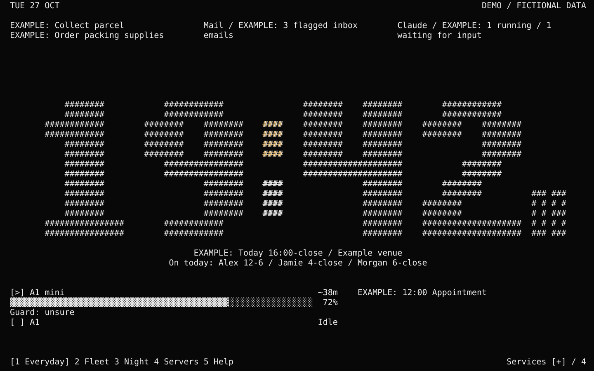

# HashDash

A quiet terminal clock that earns its screen space. Large hash-built digits and tiny hash seconds sit between modular reminders, printer progress and server status.



Built for a 2013 i7 MacBook repurposed as a Proxmox server. The display runs directly on a Linux console: no browser, desktop session, video streams or third-party Python packages. The original installation measured about **9 MB RAM and 0.3% of one logical CPU core** over a 10-second sample. Those are measurements of that machine, not a benchmark promise.

## Try it

Python 3.10+ on Linux or macOS:

```sh
git clone https://github.com/JacksonR64/HashDash.git
cd hashdash
python3 dashboard/dashboard.py --demo
```

Demo mode uses fictional data and makes no network calls. A 120-column ×37-row terminal matches the original installation. Smaller terminals use a simpler layout.

```sh
python3 dashboard/dashboard.py --demo --preview --columns 120 --rows 37
python3 -m unittest discover -s dashboard
```

## Views

| Key | View | Purpose |
| --- | --- | --- |
| 1 | Everyday | Quiet clock, reminders/mail/agent status above, printers/calendar below |
| 2 | Fleet | More printer detail, including existing AI verdicts, confidence and check age |
| 3 | Night | Clock and next known alarm/shift; neutral colon |
| 4 | Servers | Individual host/service checks and their reasons |
| 5 | Help | Colour key and the current reason for each colon dot |

Tab/arrows cycle views. `+`/`-` adjusts brightness where the Linux backlight interface exists. `Q` exits. The clock keeps the same size and position between views.

### The colon does two jobs

**Upper dot = printers. Lower dot = services.**

| Colour | Meaning | Examples |
| --- | --- | --- |
| White | Current checks OK | Connected idle printer; current positive checks |
| Amber/yellow | Needs attention | Paused print, uncertain/suspected AI result, service warning |
| Red | Reported/confirmed fault | Last print reported failed; explicit offline host or stopped Tailscale backend |
| Dim grey | Unknown or stale | Missing source, old result, earlier-job verdict or unavailable AI coverage |

An AI suspicion is **not** a confirmed failed print. Confidence describes the AI's judgement, not the chance the print will succeed. Missing data never becomes a healthy tick. Press **5** for the explanation and current causes; press2/4 for detailed sources.

## How it works

The renderer reads small independent JSON summaries every five seconds. Collectors run separately, write atomically, retain private file permissions and keep the original timestamps on failure. Each module has its own freshness limit. The clock uses Europe/London time, including daylight-saving changes, and continues when a source fails.

`dashboard/layout.json` controls views, module placement, limits and age thresholds. Ordinary modules supply a timestamp and text lines; printers and services can also provide structured items. The dashboard does not control printers or modify source apps.

The included adapters cover BamBuddy status, existing PrintGuard/Obico results, Proxmox resources, Home Assistant endpoint checks, OpenWrt heartbeat/WAN data, Tailscale and observed Claude CLI session metadata. A macOS reference adapter and native Calendar reader show how private calendar/reminder/rota feeds connect. They require local providers and permissions; they are not an automatic Apple-account login.

See [integration details and data format](docs/integrations.md) and [Linux console installation](docs/linux-console.md). Example source configs contain only placeholders. No live credentials, personal feeds, roster files, system backups or screenshots are included.

## Development

```sh
python3 -m unittest discover -s dashboard
python3 tools/render_preview.py
python3 tools/render_preview.py --view help --output docs/help.svg
```

The public preview is generated from the real text renderer and fictional records. It is a static screenshot-style illustration, not a live feed. Hardware-specific collectors fail independently; run the demo before configuring a real installation.

